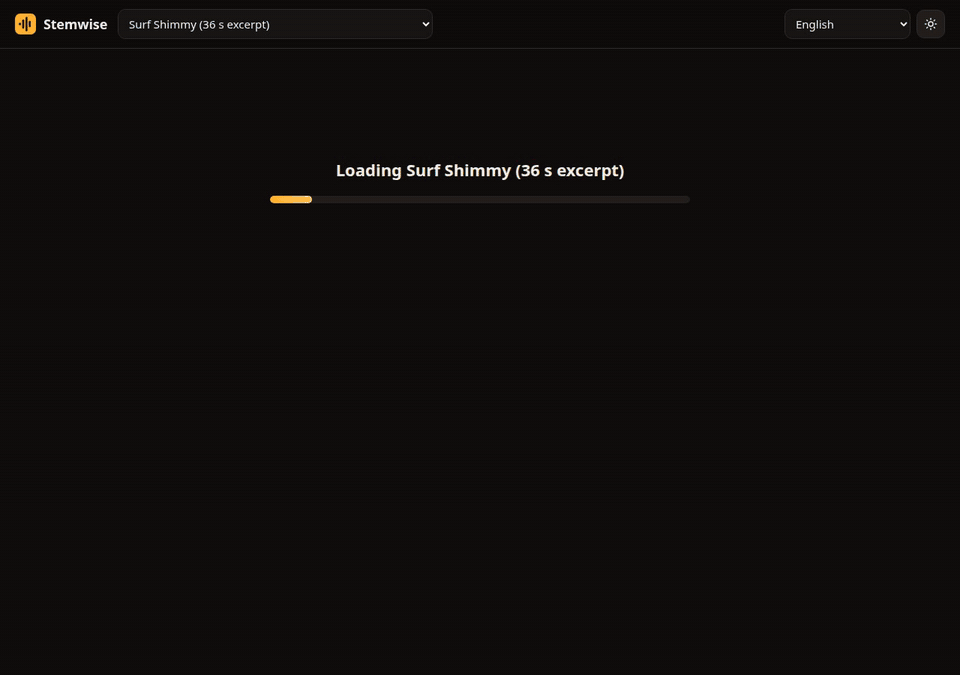

# Stemwise

Ein lokales Übungsstudio. Es trennt einen Song in sechs Spuren, zeigt Akkorde und Beats und verlangsamt eine Schleife, ohne die Tonhöhe zu ändern.

[Live-Demo](https://arthur031221.github.io/Stemwise/) | [Installation](docs/install.md) | [Verwendung](docs/usage.md) | [Konfiguration](docs/config.md) | [Architektur](docs/architecture.md) | [Benchmarks](docs/benchmarks.md)

[English](README.md) | [繁體中文](README.zh-TW.md) | [简体中文](README.zh-CN.md) | [日本語](README.ja.md) | [한국어](README.ko.md) | [Español](README.es.md) | [Français](README.fr.md) | Deutsch | [Português (Brasil)](README.pt-BR.md)



Stem-Trennung mit 122,5-facher Echtzeit auf einer RTX 5090. Ein Song von 2 Minuten und 3 Sekunden braucht 1,00 s (`stemwise bench`, fp32, bester von 3 Läufen nach einem Aufwärmlauf). Auf einem Ryzen 5 7500F mit 3 Threads braucht derselbe Song 45,2 s, also das 2,7-Fache der Echtzeit.

Deine Dateien verlassen deinen Rechner, und ich zeige dir lieber, wo die Akkordspur danebenliegt, als es zu verstecken.

## Vorher und nachher

| Eine schwierige Stelle üben | Ein normaler Player | Stemwise |
| --- | --- | --- |
| Eine Schleife auf 70 % verlangsamen | Varispeed senkt die Tonhöhe um 6,2 Halbtöne | Die Tonhöhe bleibt gleich. Ein Unit-Test zählt die Nulldurchgänge eines 440-Hz-Sinus bei 50 %, 70 % und 150 % Tempo |
| Nur den Bass hören | Mit einer Stereodatei nicht möglich | Den Bass solo schalten oder die anderen fünf Spuren stummschalten |
| Eine Begleitspur bekommen | Eine Karaoke-Version suchen | Den Mix ohne die stummgeschalteten Spuren als WAV exportieren |
| Die Akkorde finden | Zurückspulen und zuhören | Eine Akkordspur auf dem Beat-Raster. Die Grundton-Genauigkeit liegt bei 0,739 auf begleitender Gitarre und bei 0,265 auf Soli (siehe unten) |
| Zu einem Klick spielen | Ein Metronom, das du von Hand einstellst | Ein Klick, der dem Beat-Raster des Songs folgt, mit Einzähler |
| Das Tempo schrittweise steigern | Den Regler bewegen und den Überblick verlieren | Der Tempo-Trainer geht nach einer Anzahl sauberer Durchläufe einen Schritt höher (standardmäßig drei). Drücke bei einem Fehler `X`, dann beginnt die Zählung neu |

## Installation

Das Paket ist noch nicht auf PyPI, daher wird es von GitHub installiert. Du brauchst außerdem Python 3.10 oder neuer und ffmpeg.

<details>
<summary>Linux (NVIDIA-GPU oder CPU)</summary>

```sh
sudo apt install ffmpeg libsndfile1
pip install git+https://github.com/Arthur031221/Stemwise
stemwise doctor
```

Unter Linux lädt pip die große CUDA-Variante von torch. Mit `--extra-index-url https://download.pytorch.org/whl/cpu` bekommst du eine reine CPU-Installation.

</details>

<details>
<summary>macOS (Apple Silicon oder Intel)</summary>

```sh
brew install ffmpeg
pip install git+https://github.com/Arthur031221/Stemwise
stemwise doctor
```

Apple Silicon nutzt das MPS-Gerät, wenn torch es meldet. Die Geschwindigkeit auf einem Mac habe ich nicht gemessen.

</details>

<details>
<summary>Windows</summary>

```powershell
winget install Gyan.FFmpeg
pip install git+https://github.com/Arthur031221/Stemwise
stemwise doctor
```

Ich habe Stemwise nicht unter Windows ausgeführt. Die CI deckt nur Linux ab.

</details>

Die erste Analyse lädt etwa 55 MB für Demucs und 81 MB für beat_this herunter. Danach brauchst du kein Netzwerk mehr.

## Verwendung

```sh
stemwise                      # öffnet das Studio im Browser
stemwise split song.mp3       # Spuren, chords.txt und beats.mid neben der Datei
```

Echte Ausgabe von `stemwise split` für einen Song von 2 Minuten:

```
surf.mp3: 123s, 166.7 BPM, B major, 105 chords, on cuda
```

Ziehe eine Datei auf die Seite und warte auf den Fortschrittsbalken. Ziehe über das Lineal, um eine Schleife zu wählen, drücke `L`, um den Takt unter dem Abspielkopf zu wiederholen, und nutze die Tasten unten. Die vollständige Liste steht in [docs/usage.md](docs/usage.md).

| Taste | Aktion | Taste | Aktion |
| --- | --- | --- | --- |
| Space | Wiedergabe und Pause | `[` `]` | Tempo minus und plus 5 % |
| L | diesen Takt wiederholen oder die Schleife umschalten | Up, Down | um einen Halbton transponieren |
| C | Klick ein und aus | Left, Right | einen Takt springen |
| X | Fehler, für den Trainer | 1 bis 6 | eine Spur stummschalten |
| Esc | Schleife löschen | Shift + Left, Right | Schleife um einen Takt länger oder kürzer |

Stemwise merkt sich in deinem Browser Tempo, Tonhöhe, Stummschaltungen, Pegel und Schleife jedes Songs und öffnet den zuletzt benutzten Song wieder.

## Was enthalten ist

| Teil | Was es ist |
| --- | --- |
| Trennung | Demucs v4 `htdemucs_6s`: Gesang, Schlagzeug, Bass, Gitarre, Klavier, Sonstiges |
| Beats | beat_this für Beats, Taktanfänge und BPM |
| Akkorde | CQT-Chromagramm, Vorlagen für Dur, Moll, 7 und min7, Viterbi-Glättung und Tonartschätzung. Kein neuronales Akkordmodell |
| Player | Eine AudioWorklet-Engine mit WSOLA-Zeitdehnung, kubischem Resampler, Schleifen, Klick und Einzähler |
| Studio | ES-Module und CSS ohne Build-Schritt, neun Oberflächensprachen, dunkles und helles Design |
| Exporte | Begleitspur, Zip der Stems, Akkordblatt als Text oder druckbares HTML, Beat-Raster als MIDI |
| API | Eine kleine lokale JSON-API, beschrieben in [docs/usage.md](docs/usage.md) |

Die Browser-App liegt in `web/`, demselben Ordner, den GitHub Pages als Live-Demo ausliefert. Die Demo spielt einen bereits getrennten Song ab und kann deine Dateien nicht trennen.

## Wie gut es funktioniert

Ich habe `bench/chords_guitarset.py` auf [GuitarSet](https://guitarset.weebly.com/) ausgeführt (360 Clips mit Solo-Gitarre). Die Akkordkonstanten habe ich an jedem fünften Clip abgestimmt und die übrigen 288 bewertet.

| Clips | Grundton | Dur und Moll | Beat F | Taktanfang F |
| --- | --- | --- | --- | --- |
| Begleitung, 144 | 0.739 | 0.671 | 0.971 | 0.944 |
| Soli, 144 | 0.265 | 0.201 | 0.605 | 0.403 |

Die Beats sind bei begleitenden Parts verlässlich. Die Akkorde sind ein Ausgangspunkt, um einen Song zu lernen, prüfe sie also nach Gehör. Ein Solo aus Einzelnoten enthält kaum Akkordinformation, und die Spur liegt dort meistens falsch. Diese Clips sind Solo-Gitarre, ich kann also nicht sagen, wie ein Mix einer ganzen Band abschneidet. Die vollständige Tabelle und die Methode stehen in [docs/benchmarks.md](docs/benchmarks.md).

## Grenzen

- Die Akkordspur kennt vier Akkordtypen. Slash-, Sus- und erweiterte Akkorde erscheinen als der nächstliegende der vier.
- Die Tonart ist eine einzige Schätzung für den ganzen Song. In der Ausgabe oben steht H-Dur, während die Akkorde überwiegend Em, D und Bm sind, nimm sie also als Hinweis.
- Das angezeigte Tempo ist der Median des Beat-Detektors und kann vom veröffentlichten Tempo abweichen. Der Demo-Song ist mit 170 BPM angegeben, der Detektor liefert 166,7.
- Ein instrumentaler Song lässt die Gesangs- und Klavierspur fast leer. Das ist die Trennung, die richtig arbeitet.
- Auf einer CPU braucht ein vierminütiger Song bei den gemessenen 2,7-facher Echtzeit etwa 90 Sekunden, auf langsameren Chips mehr.
- Die Zeitdehnung ist WSOLA und kann gehaltene Töne bei den langsamsten Einstellungen verschmieren.
- Es wird immer nur ein Song gleichzeitig verarbeitet.

## Entwicklung

```sh
pip install -e ".[dev]"
ruff check . && pytest -m "not slow and not e2e"
node --test tests/js/*.test.mjs
STEMWISE_BROWSER_CHANNEL=chrome pytest -m e2e
```

Siehe [CONTRIBUTING.md](CONTRIBUTING.md). Ein Tag, der mit `v` beginnt, startet den Release-Workflow, der Wheel und Sdist baut und an ein GitHub-Release hängt.

## Danksagung und Lizenzen

Stemwise steht unter der MIT-Lizenz. Es baut auf [Demucs](https://github.com/facebookresearch/demucs) (MIT), [beat_this](https://github.com/CPJKU/beat_this) (Code und Gewichte MIT), librosa und Starlette auf. Die Live-Demo spielt "Surf Shimmy" von Kevin MacLeod ([incompetech.com](https://incompetech.com)), lizenziert unter [CC BY 4.0](https://creativecommons.org/licenses/by/4.0/), auf einen Ausschnitt von 36 Sekunden gekürzt und mit Stemwise getrennt. GuitarSet stammt von Xi et al. (2018), CC BY 4.0.

Assisted by Claude/Codex.
